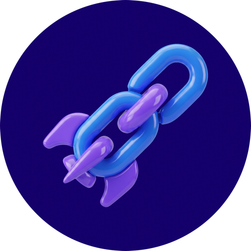

<p align="center">
  
</p>

# Rus.sh MCP server

[](https://glama.ai/mcp/connectors/sh.rus/mcp)

Make, find, pause and track short links and QR codes from your AI assistant.

[Rus.sh](https://rus.sh) is a link shortener with QR codes and click analytics. Its MCP server is hosted, so you don't install or run anything: add the address below to your assistant and sign in.

```
https://rus.sh/mcp
```

- **Transport:** Streamable HTTP
- **Sign-in:** OAuth 2.1. Your assistant opens Rus.sh, you sign in and choose what it may do. An API key also works.
- **Plans:** every plan, including Free.
- **MCP Registry:** [`sh.rus/mcp`](https://registry.modelcontextprotocol.io/v0.1/servers?search=sh.rus)

## What your assistant can do

| Look things up | Make new links | Change and undo |
|---|---|---|
| Get account, list links, get link, list QR codes, get QR code, get account / link / QR code analytics | Create link | Update link; archive, restore, pause and resume links; archive and restore QR codes |

The assistant works within the permissions you approve and can never permanently delete anything. Every change can be undone.

## Connect your assistant

Step-by-step guides with copy buttons are at **[rus.sh/pages/ai](https://rus.sh/pages/ai)**. Signed-in users also have them under **user menu → Connect an AI app**.

**Claude (claude.ai and Claude Desktop):** Customize → Connectors → Add → Add custom connector. Name it Rus.sh, paste `https://rus.sh/mcp`, then choose Add and Connect.

**ChatGPT:** Plugins → Add → Add custom MCP server. Name it Rus.sh, keep OAuth, paste `https://rus.sh/mcp`, then create it and connect.

**Claude Code:**

```bash
claude mcp add --transport http -s user rus-sh https://rus.sh/mcp
```

Then type `/mcp` in Claude Code, choose `rus-sh` and sign in.

**Cursor:** use **Add to Cursor** on [rus.sh/pages/ai](https://rus.sh/pages/ai), or add this to `~/.cursor/mcp.json`:

```json
{ "mcpServers": { "rus-sh": { "url": "https://rus.sh/mcp" } } }
```

**VS Code:** use **Add to VS Code** on [rus.sh/pages/ai](https://rus.sh/pages/ai), or add this to `.vscode/mcp.json`:

```json
{ "servers": { "rus-sh": { "type": "http", "url": "https://rus.sh/mcp" } } }
```

**Codex:**

```bash
codex mcp add rus-sh --url https://rus.sh/mcp
codex mcp login rus-sh
```

**Gemini CLI:**

```bash
gemini extensions install https://github.com/sweenttech/rus-sh-mcp
```

**With an API key instead of signing in:** create a key at [rus.sh/app/api-keys](https://rus.sh/app/api-keys) and send it as `Authorization: Bearer <key>`.

## What's in this repository

This repository holds only the files that directories and assistants read: the registry entry (`server.json`), the Cursor plugin (`.cursor-plugin/plugin.json`, `mcp.json`), the Gemini CLI extension (`gemini-extension.json`) and install notes (`llms-install.md`). The Rus.sh service itself is not open source.

## Support and policies

- Support: support@rus.sh
- Privacy Policy: https://rus.sh/pages/privacy (section 3.6 covers connected apps)
- Terms of Service: https://rus.sh/pages/terms

The files in this repository are MIT-licensed. The Rus.sh name and logo are trademarks of Sweent LLC.
